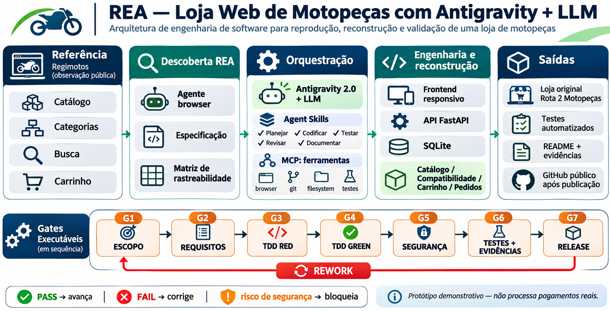

# Rota 2 Motopeças — Engenharia de Software + IA + REA (REV04)



> **Status: MVP DIDÁTICO (não é uma loja comercial).** Projeto original baseado em observação de funcionalidades públicas de um site de referência. Não copia marca, textos, imagens, layout proprietário nem catálogo de terceiros. Não coleta nome, e-mail, CPF, endereço, telefone ou dados de pagamento. Não recebe pagamentos nem realiza entregas.

## Percursos REV04 — A, B e C

**A — workflow agêntico**: Antigravity + LLM + Rules + Skills próprias para requisitos, TDD e gates; não exige o pacote REA oficial. **B — REA oficial**: `rea-agents` executado por CLI ou MCP para inspeção técnica de alvo autorizado; não prova equivalência de implementação. **C — integração**: evidência real de B, aceita por decisão humana, alimenta requisitos, testes, código, gates e revisão independente em A. **São modos de trabalho, não três produtos.**

Os materiais REV04 do docente contêm **85 slides** e um **guia de laboratório de 19 páginas**. O repositório ainda **não contém comprovação de execução real de Antigravity + REA/MCP**, nem da revisão independente. Configuração, `doctor`, tools disponíveis, chamada executada e evidência útil são níveis diferentes de prova.

**Laboratório/segurança:** [roteiro A/B/C REV04](docs/labs/REA_AB_C_REV04.md) · [auditoria REV04](docs/REV04_SYNC_AUDIT.md) · [template de Evidence (não executado)](docs/evidence/rea-observation-template.md).

**Categoria de laboratório RF-03:** use `Freios` (existente) e confira resultado não vazio. O exemplo `capacetes` no guia não corresponde ao catálogo Rota 2; HTTP 200 com lista vazia não valida o filtro.

## 1. Problema de engenharia

Demonstrar, de ponta a ponta, uma instância reprodutível de **REA (Reverse Engineer Anything, como metodologia didática)** para reconstrução *funcional* de uma loja virtual simples de peças de motocicletas usando **agentes de IA, LLM, ferramentas locais e gates executáveis**. Não se trata de engenharia reversa do código proprietário da loja nem de clonagem visual pixel-a-pixel.

- **Referência observada em 03/11/2026:** [Regimotos — Loja](https://regimotos.com.br/loja/). Na página pública, foram identificados grupos de produtos, faixa de preço, itens com preço e opção de adicionar ao carrinho. Evidências e limites em [`docs/discovery.md`](docs/discovery.md).
- **Marca nova:** Rota 2 Motopeças (fictícia).
- **Catálogo:** 12 produtos / 6 categorias / 6 modelos, dados e preços **sintéticos**.
- **Stack:** HTML/CSS/JavaScript puro + Python 3.11+ / FastAPI / Pydantic / SQLite.
- **Pagamento, frete e identidade de cliente:** fora do escopo por decisão de minimização de dados e segurança.
- **Agente principal no Antigravity:** agente de desenvolvimento com acesso limitado ao workspace, e agente revisor independente sem permissão para alterar a evidência.
- **Diferencial:** pedido transacional com verificação de estoque e idempotência, teste automatizado, validação de segurança inicial, relatório com SHA-256 dos fontes.

## 2. Requisitos implementados

| ID | Função | Evidência |
|----|--------|-----------|
| RF-01 | Listar catálogo e categorias | `GET /api/products`, `GET /api/categories` |
| RF-02 | Busca por termo e SKU | `GET /api/products?q=...` |
| RF-03 | Filtrar por categoria | `GET /api/products?category=...` |
| RF-04 | Filtrar compatibilidade por modelo/ano | `GET /api/products?bike=...&year=...` |
| RF-05 | Carrinho com quantidades e subtotal | `static/app.js` |
| RF-06 | Criar pedido **simulado** | `POST /api/orders` |
| RF-07 | Controle transacional de estoque | `app/main.py` (`BEGIN IMMEDIATE`) |
| RF-08 | Evitar processamento duplo (idempotência) | cabeçalho `Idempotency-Key`, teste automatizado |
| RF-09 | Consultar indicadores sem dados pessoais | `GET /api/metrics` |
| RF-10 | Gestão de estoque local | `python -m app.manage stock <SKU> <QTD>` |

**Limites do domínio:** compatibilidades e aplicações dos produtos são hipotéticas; valores, imagens e marcas reais não devem ser inferidos a partir do protótipo. A UI não exibe frete, impostos, parcelamento ou disponibilidade de entrega, pois não há checkout comercial.

## 3. Execução local — Windows PowerShell

```powershell
# 1. Descompacte o ZIP e entre na pasta
cd .\rea-motopecas-antigravity

# 2. Crie/ative o ambiente
py -3.11 -m venv .venv
.\.venv\Scripts\Activate.ps1

# 3. Dependências
python -m pip install --upgrade pip
python -m pip install -r requirements-dev.txt

# 4. Inicie a aplicação
python -m uvicorn app.main:app --host 127.0.0.1 --port 8000 --reload
```

No navegador: **http://127.0.0.1:8000**. Documentação interativa da API: **http://127.0.0.1:8000/docs**.

Alternativa Linux/macOS: `python3 -m venv .venv && source .venv/bin/activate`, depois os mesmos comandos com `python`.

### Testes e evidências

Em outro terminal com o ambiente ativado:

```powershell
python -m pytest -q
python scripts/gate.py
python -m pip_audit -r requirements.txt
```

O gate local escreve [`docs/evidence/gate-report.json`](docs/evidence/gate-report.json) com status de `compileall`, testes e SHA-256. Os hashes só valem para o snapshot gerado: **ao alterar código, execute novamente**. O comando `pip-audit` é um gate complementar de dependências que depende da instalação e da base de vulnerabilidades acessível; não está representado como executado no relatório local.

### Consultas úteis

```powershell
curl.exe http://127.0.0.1:8000/api/health
curl.exe "http://127.0.0.1:8000/api/products?category=Freios"
python -m app.manage orders
python -m app.manage stock R2-FR-001 30
```

**Atenção:** criar pedidos reduz o estoque no banco local `data/motopecas.db`. Para restaurar os dados iniciais, interrompa o servidor e apague **somente o banco DEMO local** antes de reiniciar.

## 4. REA e orquestração por Antigravity

O workflow é definido como **Agent Skills** de workspace, não como workflows `.agents/workflows/*.md`, que foram substituídos. Consulte [documentação oficial](https://antigravity.google/docs/migration/workflows-to-skills).

```text
.agents/
  rules/rea.md                        # Guardrails persistentes
  skills/rea-discovery/SKILL.md       # Agente de descoberta
  skills/rea-build/SKILL.md           # Agente de engenharia/TDD
  skills/rea-verify/SKILL.md          # Agente de verificação independente
```

No **Antigravity 2.0** (ou IDE compatível):

1. Abra a pasta raiz como **Project**. Restrinja as permissões ao repositório e habilite revisões antes de comandos destrutivos ou publicações. Não configure chaves de produção neste projeto.
2. Em uma conversa nova, use `/rea-discovery` para atualizar a especificação a partir da observação **pública e permitida** do site da referência. Registre o que foi realmente observado vs. hipóteses.
3. Use `/rea-build` para implementar **um requisito por vez**, com teste inicialmente vermelho e depois verde. Não salte gates.
4. Use **uma nova conversa/agente de revisão**, sem reutilizar justificativas do agente implementador, e execute `/rea-verify` com os artefatos e relatórios; registre lacunas como `NOT VERIFIED`, nunca como `PASS`.
5. Execute `python scripts/gate.py` antes de qualquer proposta de entrega. Revise o diff, licenças e a matriz de rastreabilidade.
6. Abra um PR para aprovação humana antes de merge/implantação pública. A implantação depende da configuração de um ambiente, HTTPS, banco adequado e controles comerciais que **não fazem parte deste MVP**.

Fluxo com gates: **G1 escopo → G2 descoberta → G3 requisitos → G4 TDD → G5 segurança → G6 evidências independentes → G7 entrega**. Cada `FAIL` gera issue/rework; escopo não suportado gera `UNSUPPORTED_CAPABILITY`; credenciais/ferramentas ausentes geram `NEEDS_HUMAN/FAIL_CLOSED`. Detalhamento: [`docs/REA_WORKFLOW.md`](docs/REA_WORKFLOW.md).

## 5. Organização do código

```text
app/
  catalog.py         # Produtos fictícios e matriz de compatibilidade
  db.py              # Esquema SQLite + seed
  main.py            # FastAPI, consultas e pedidos atômicos
  manage.py          # CLI administrativo local
static/
  index.html         # Aplicação web responsiva
  styles.css         # Design system original
  app.js             # Busca, filtros, carrinho e pedido
  img/*.svg          # Ilustrações originais
tests/               # Testes de API, CLI, RF-03 e contrato documental
docs/                # Descoberta, riscos, workflow, rastreabilidade
.agents/             # Rules e Skills do Antigravity
.github/workflows/   # CI no GitHub Actions
scripts/gate.py      # Gate local reproduzível
```

## 6. Arquitetura e segurança

- **Front-end** serve arquivos estáticos da própria aplicação; sem CDN ou JavaScript externo.
- **API** valida entradas via Pydantic, usa parâmetros SQL e calcula valores financeiros **no servidor** como centavos inteiros.
- **Checkout** executa `BEGIN IMMEDIATE`; valida disponibilidade e debita estoque junto com a criação de pedido dentro de uma transação. Reenvios usam `Idempotency-Key`, comparando hash da carga útil.
- **CSP e headers básicos** reduzem parte da superfície de ataque, mas não substituem revisão de segurança.
- **Privacidade por padrão:** nenhuma captura de identificação do comprador, senha, CPF, e-mail, pagamento ou endereço.
- **Gestão de estoque** apenas por CLI local para não expor endpoint administrativo desprotegido.
- **Limites conhecidos:** sem autenticação de usuário, limitação de taxa, observabilidade remota, antifraude, integração com gateway, envio de e-mail, conformidade comercial ou SLA. **Não publique como e-commerce de produção.**

Consulte: [`docs/threat-model.md`](docs/threat-model.md), [OWASP ASVS 5.0](https://asvs.owasp.org/) e [LGPD](https://www.planalto.gov.br/ccivil_03/_ato2015-2018/2018/lei/l13709.htm).

## 7. GitHub — repositório existente

O repositório **já está publicado**, portanto não executar novamente `git init` ou `gh repo create`. Clonar, criar branch isolada e propor mudanças por PR após gates e revisão humana:

```powershell
git clone https://github.com/FGarcia9999/rea-motopecas-antigravity.git
cd rea-motopecas-antigravity
git checkout -b lab/rf03-equipe
# editar em branch, executar testes e revisar diff
git diff --check
```

CI verde comprova somente os checks configurados; **não** equivale a autorização de publicação, equivalência funcional completa, sessão REA/MCP ou revisão independente.

## 8. Evidência e fidelidade

- [`docs/discovery.md`](docs/discovery.md) diferencia **observação vs. inferência** sobre a referência.
- [`docs/traceability.csv`](docs/traceability.csv) liga requisitos aos testes e gates.
- [`docs/architecture.mmd`](docs/architecture.mmd) é o diagrama **editável** (Mermaid).
- [`docs/arquitetura-rea.png`](docs/arquitetura-rea.png) é a versão gráfica didática.
- [`docs/evidence/gate-report.json`](docs/evidence/gate-report.json) evidencia testes locais executados.
- Revisão semântica por agente independente **não foi executada neste ambiente**; é uma etapa operacional especificada para o Antigravity.

## 9. Referências técnicas

1. Google Antigravity. [Agent Skills](https://antigravity.google/docs/skills).
2. Google Antigravity. [Migrating workflows to skills](https://antigravity.google/docs/migration/workflows-to-skills).
3. OWASP. [Application Security Verification Standard — 5.0](https://asvs.owasp.org/).
4. NIST. [Secure Software Development Framework (SSDF), SP 800-218](https://csrc.nist.gov/pubs/sp/800/218/final).
5. Presidência da República. [Lei 13.709/2018 — LGPD](https://www.planalto.gov.br/ccivil_03/_ato2015-2018/2018/lei/l13709.htm).

**Licença:** MIT para o código original. O site de referência e suas marcas permanecem de seus respectivos titulares.

## 10. Capturas de interface (preview offline)

- [Desktop — catálogo e interface](docs/evidence/desktop-preview.png)
- [Mobile — versão responsiva](docs/evidence/mobile-preview.png)

As capturas usam dados de API simulados no Chromium; os testes transacionais do servidor foram conduzidos separadamente. Veja [proveniência das capturas](docs/evidence/preview-notes.md). Para reproduzir, instale Playwright e um Chromium compatível no seu ambiente.
